

# 📸 FolioSort 5

### 20 years of photos. One messy drive. Sorted in an afternoon.

**FolioSort is a photo manager for macOS and Windows that works on the folders your photos are already in.** It shows every photo on every drive you own as one library — timeline, map, people, events — finds any photo with AI that runs on your computer, files everything into clean dated folders from the EXIF inside each file, fixes wrong dates and places *inside* the files, culls a shoot for Lightroom, cleans out duplicates and blurry shots, and keeps a backup that proves it is a copy.

**Nothing imported. Nothing uploaded. Pay once, own it forever.**

### 🎉 [FolioSort 5 is out for Mac](https://github.com/tiagotrindade/FolioSort/releases/latest) — Windows follows soon

 

| 🍎 **macOS 14+** · FolioSort 5.0.0 | 🪟 **Windows 10/11** · FolioSort 4.9.9 |
|:---:|:---:|
| [**⬇️ Download FolioSort.dmg — free**](https://github.com/tiagotrindade/FolioSort/releases/latest/download/FolioSort.dmg) | [**Get it from the Microsoft Store — free**](https://apps.microsoft.com/detail/9nlw1xwgk181?cid=github) |
| Apple Silicon & Intel · Signed & notarized by Apple | One-click install · Auto-updates · FolioSort 5 coming soon |

**No account · no card · no upload.** The Library is free with no limit, and Google Takeout import is free forever.

**Jump to:** [What's new in 5](#-whats-new-in-foliosort-5) · [Screenshots](#-library--every-photo-on-every-drive-in-one-timeline) · [Who it's for](#who-its-for) · [Pricing](#-pricing--pay-once-own-it-forever) · [Compare](#how-foliosort-compares) · [FAQ](#faq) · [Install](#how-to-install)

 

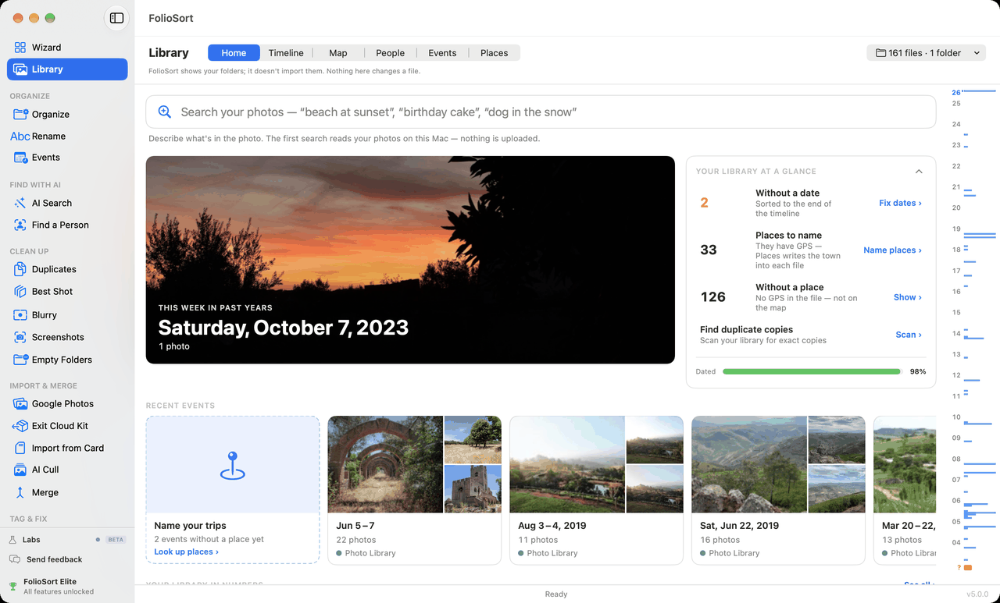

Real app, real photos — FolioSort 5.0.0 on macOS.

 

| **91** | **90+** | **20M+** | **0** |
|:---:|:---:|:---:|:---:|
| photo, video & RAW formats | countries it's used in | files processed | subscriptions, accounts or uploads |

---

## Sound familiar?

> *"I exported my Google Photos via Takeout and got 40 GB of files with broken dates and useless names."*

> *"I have 80,000 photos across ten cameras, three phones and four external drives. I can never find anything."*

> *"Every shoot lands in `~/Downloads`. I don't cull, I don't sort, I just buy a bigger drive."*

> *"My backup drive is ten years old. I have no idea if the photos on it still open."*

FolioSort reads the **EXIF metadata, GPS coordinates and capture dates** already inside your files and turns chaos into a library you can actually use — without moving your photos into anyone's database, and without sending a single one to the cloud.

---

## 💬 From people who bought it

> **"In just one night, I organized about 100,000 photographs!"**
> — Matteo P. · Elite licence · Mac

> **"You have saved me literally hundreds of hours, and beyond that, improved my mental health beyond measure."**
> — Benjamin K. · Elite licence · Windows

> **"FolioSort's AI scans what's in my photos, so I can find images for social media by searching in plain English, such as 'people on the beach'. It saves me tagging thousands of photos by hand."**
> — Martin, [GoVegan Travel](https://govegantravel.com) · Elite licence · Windows

> **"I never thought I could organize all my family photos so fast. Truly amazing!"**
> — Maria · Portugal

Four of them, not four thousand — these people wrote in after buying, and the words are theirs.

---

## ✨ What's new in FolioSort 5

Until now FolioSort was something you *ran*: point it at a messy folder, get a tidy one back. **FolioSort 5 is somewhere you stay.**

| | |
|---|---|
| 🖼️ **The Library** | Every photo on every drive in one timeline, map, people and events view — an index, not an import. Unplugged drives stay on screen, greyed. **Free, no limit.** |
| 🎯 **AI Cull** | Cull a whole shoot with K / R, stars and colour labels; near-identical frames stacked, the sharpest suggested. **Write for Lightroom** as standard XMP ratings. |
| 🏆 **Best Shot** | The best frame of every near-identical burst — eyes open, faces, focus — beside Duplicates. You confirm. |
| 🏷️ **AI Tags** | Keywords proposed by the on-device AI, written into your files as XMP + IPTC keywords that Lightroom, Apple Photos and Windows read. |
| 📍 **Places** | GPS turned into city / region / country *inside the file* — and a place for camera photos without GPS, taken from the phone photos shot around them. |
| 📅 **Dates** | Fill missing capture dates from file or folder names, shift a camera whose clock was wrong, date your scanned prints. |
| ✏️ **Edit metadata** | Title, caption, keywords, author, copyright, rating — across a whole selection, reviewed in a table, undone in one click. |
| 🛡️ **Backup Copy** | Every file read back from the backup and compared by hash before it counts. Nothing is ever deleted from the backup. |
| 🩺 **Archive Health** | Finds the photos that changed, went missing or quietly rotted — and restores them from the verified copy. |
| 📊 **Your library in numbers** | Space used, most-used camera, busiest day — and a share card made on your computer. |
| 🧪 **Labs (Beta)** | Resize & Shrink, Bulk Crop, Combine Photos, Reminder Photos, Moved Files Map — and **Ask Your AI**. |
| 🤖 **Ask Your AI (MCP)** | Let **Claude Desktop**, ChatGPT's Codex and other MCP apps search your photo library — read-only, no image ever sent. |

**FolioSort 5 is a free update for everyone who bought Pro or Elite.** → [Full release notes](https://github.com/tiagotrindade/FolioSort/releases/tag/v5.0.0)

---

## 📚 Library — every photo on every drive, in one timeline

FolioSort reads the folders and drives your photos are already on and shows them as **one library**: by year, month and day, on a map, by person and by event. Nothing is imported or copied — FolioSort shows your folders; it doesn't take them over.

- **Six views** — Home, Timeline, Map, People, Events and Places. Zoom from decades down to a single day.
- **Ghost tiles** — unplug a drive and its photos *stay*, greyed, with the name of the drive to go and get. Plug it back in and they fill in, in place, with no rebuild.
- **RAW + JPEG as one photo**, and a Live Photo's video behind its still.
- **A Home for your photos** — *On this day*, recent events named by where and when, and a short list of what needs fixing.
- **A proper viewer** — zoom, full screen, details, video, rotate with Undo.
- **Free on every tier**, with no limit. People with faces is Elite.

<table>
<tr>
<td width="50%">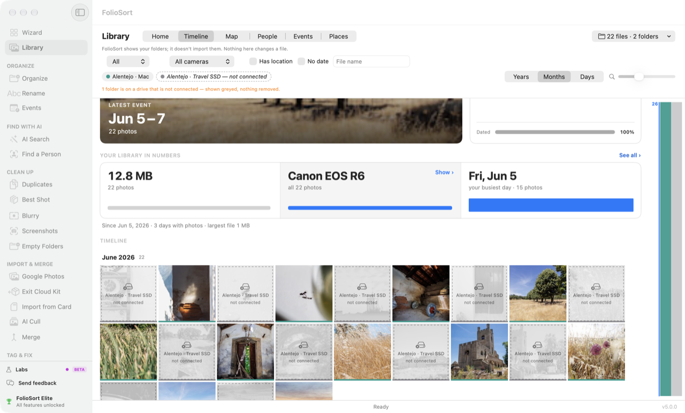 <b>One drive unplugged</b> — its photos stay, greyed, nothing removed.</td>
<td width="50%">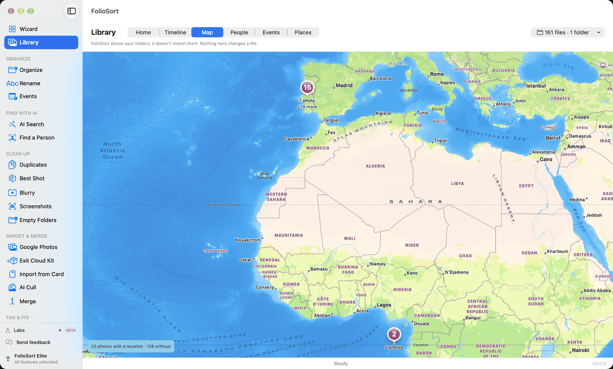 <b>Map</b> — where every photo was taken.</td>
</tr>
<tr>
<td width="50%">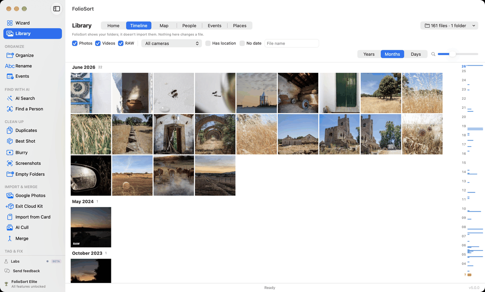 <b>Timeline</b> — years, months, days.</td>
<td width="50%">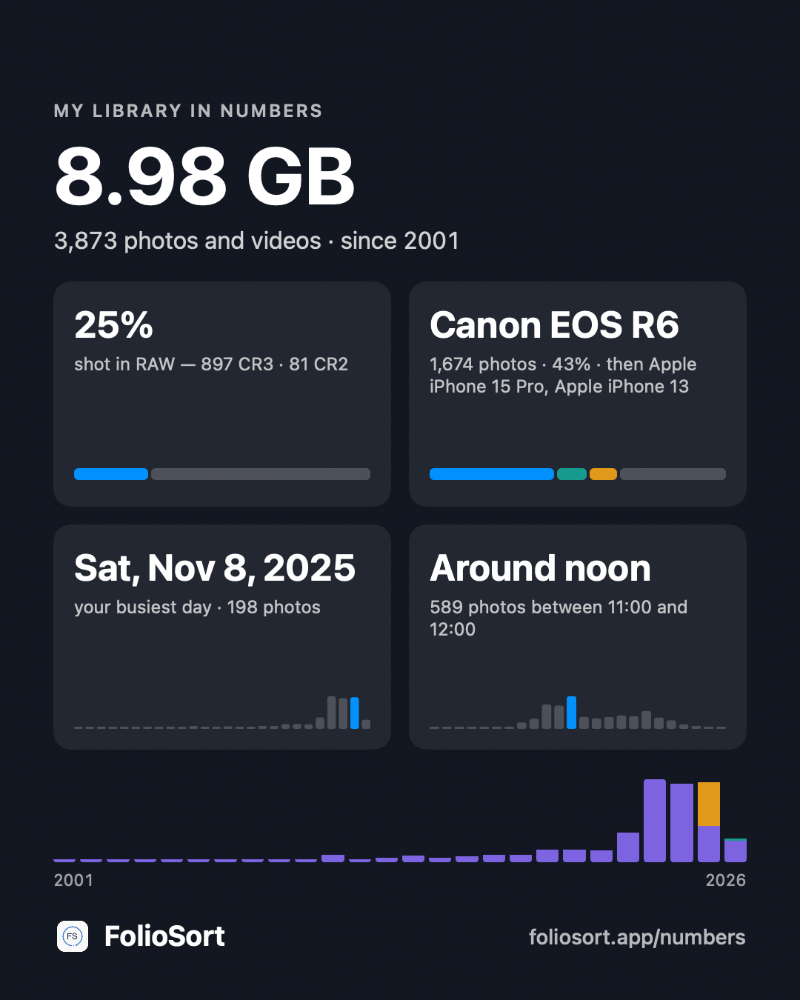 <b>Your library in numbers</b> — a share card, made on your computer.</td>
</tr>
</table>

---

## 🗂️ Organize — by date, camera and place, automatically

Every photo already knows when and where it was taken. FolioSort reads the EXIF inside each file and builds your folder structure from it — `2024 › 06 June › Lisbon` — and shows you the **exact folder tree before a single file moves**.

- **Folder templates with 28 tokens** — `{YYYY}/{MM}/{Camera}/{City}`, `{Maker}`, `{Quarter}`, `{ParentFolder}`. Four presets, or build your own.
- **Copy mode by default**, every transfer **checksum-verified** (XXHash64 / SHA-256), **Undo up to 50 batches**.
- **Regex mass rename** with live before/after preview.
- **Event time-blocks** — Getting Ready, Ceremony, Reception: every camera's photos land in the right act.
- **Live Photos stay together** — HEIC + MOV, or Takeout HEIC/JPG + MP4.

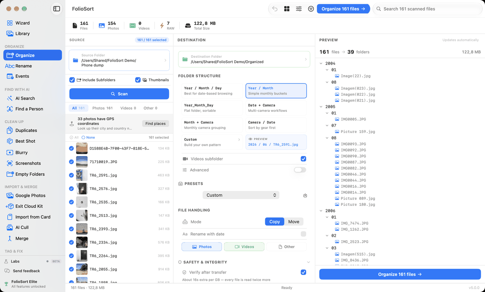

### 📍 Tag & Fix — the facts, written into the file

When a file is wrong about its date, its place or its keywords, FolioSort fixes it **inside the file**, so the fix survives leaving FolioSort. Lightroom, Bridge, Photo Mechanic, Capture One and Apple Photos read the same values. Proprietary RAW files get a sidecar and are **never modified**; every write is reviewed first and **undone as one batch**.

<table>
<tr>
<td width="33%">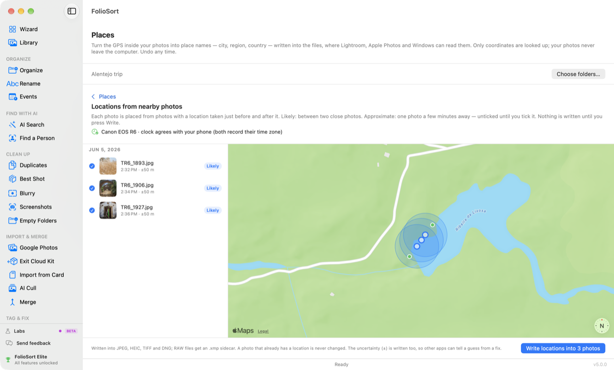 <b>Places</b> — a location from the phone photos taken nearby.</td>
<td width="33%">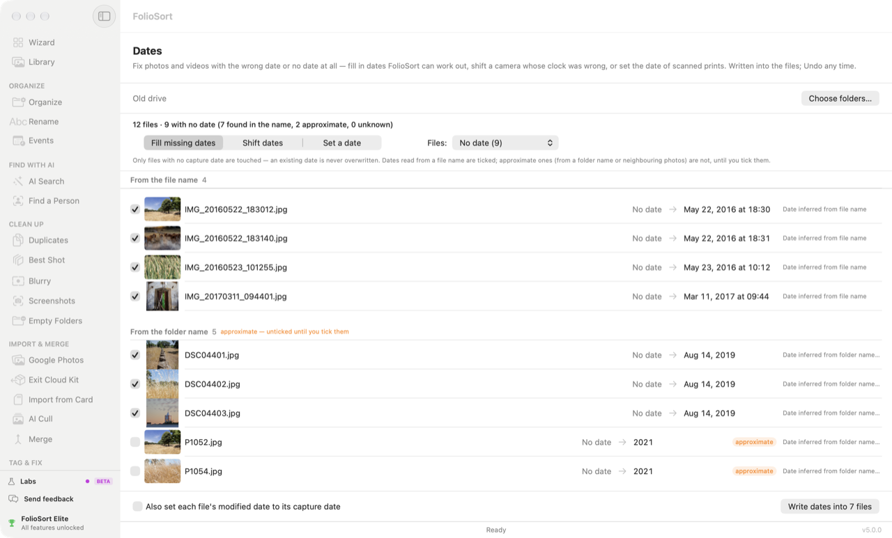 <b>Dates</b> — missing dates filled in; existing dates never overwritten.</td>
<td width="33%">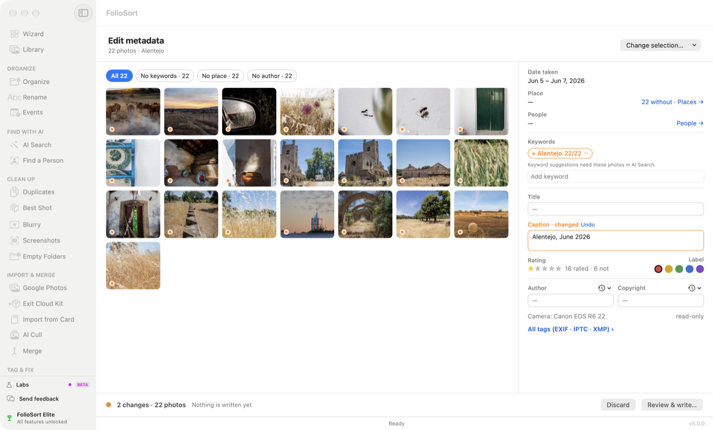 <b>Edit metadata</b> — 22 photos at once.</td>
</tr>
</table>

---

## 🧹 Clean — duplicates, blurry shots, screenshots, and a whole shoot culled

Years of camera dumps hide gigabytes of clutter. FolioSort finds it — **you approve every removal**, everything goes to the system Trash / Recycle Bin, and everything is undoable.

- **Duplicates** — byte-identical copies *and* re-saved, resized, re-compressed versions of the same photo. Only true byte-for-byte copies ever arrive pre-selected; visual matches arrive unticked as *"possible match"*. Duplicates and Best Shot remember the last scan.
- **Best Shot** — near-identical shots grouped, the best one marked **with its reason** (eyes open, best faces, eyes in focus).
- **Blurry** — a sharpness score per photo, blurriest first, a live slider with no re-scan.
- **Screenshots** — receipts, memes and UI captures pulled out of your photo timeline.

<table>
<tr>
<td width="50%">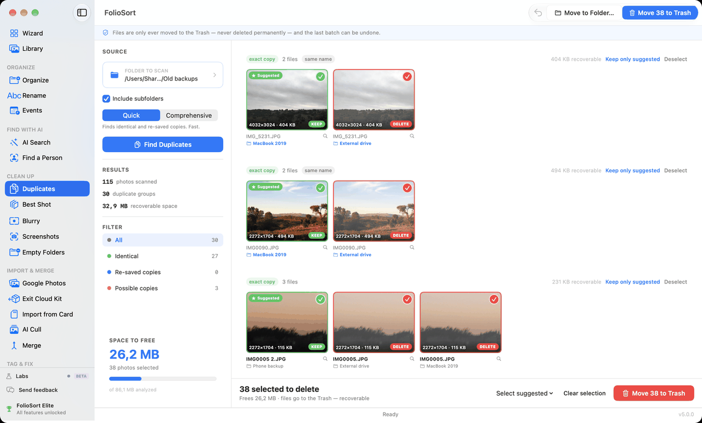 <b>Duplicates</b> — exact and visually similar copies, grouped.</td>
<td width="50%">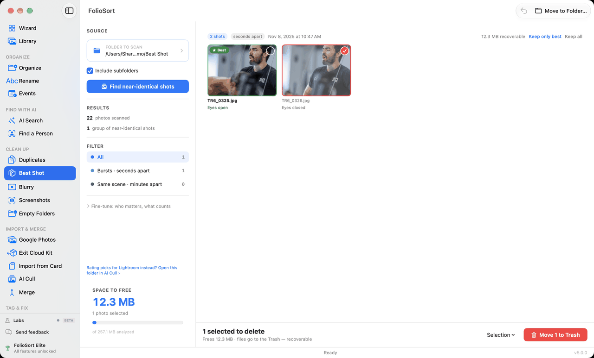 <b>Best Shot</b> — eyes open beats eyes closed.</td>
</tr>
</table>

### 🎯 AI Cull — the cull is yours; the AI only suggests

Come back from a shoot with 2,000 frames? **K** keeps, **R** rejects, **1–5** stars, **6–9** colour labels. Near-identical frames are stacked and the sharpest is ringed — but **nothing is marked until you press a key**. Then **Write for Lightroom** puts your decisions into the files as standard XMP ratings (Capture One, Bridge and Photo Mechanic read them too). RAW files get a sidecar and are never touched.

The same job that culling apps rent for **$120+/year** — included in a one-time licence, and free on the first 20 photos of every folder.

<table>
<tr>
<td width="50%"> <b>AI Cull</b> — keep or reject with one key.</td>
<td width="50%">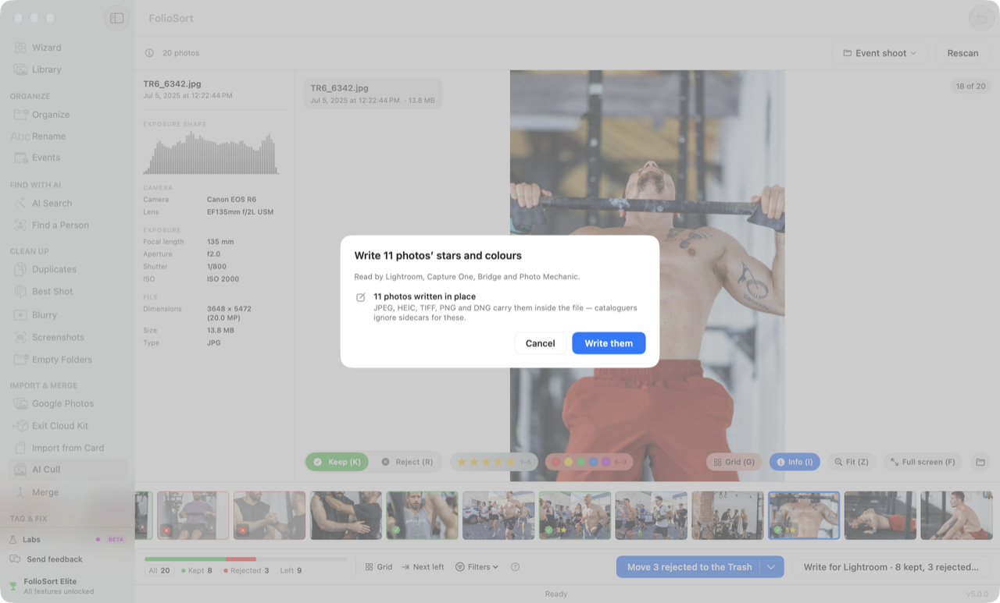 <b>Write for Lightroom</b> — standard XMP, RAW untouched.</td>
</tr>
</table>

---

## 🔎 Find — AI photo search that runs entirely on your computer

The search you gave up when you left Google Photos — except **nothing ever leaves your computer**. Turn your Wi-Fi off; it still works.

- **Search in plain language** — *"the dog on the beach"*, *"birthday cake with candles"*, *"my passport"*. **62 ms per query on a 100,000-photo library.** Ask in Portuguese, Spanish, French or German — translated on your machine.
- **People** — every face in your library grouped into people automatically, no example needed. Name someone once and the name sticks. Write the names to **XMP sidecars** for Lightroom and Capture One.
- **Find a Person** — pick one photo, find them across two decades. Move every match to a folder in one click.
- **Text in photos (OCR)** — find the Wi-Fi password screenshot from 2022.
- **AI Tags** — keywords for what the AI sees. Untick what's wrong; the rest is written into your files.
- **Smart Folders** — saved searches that fill themselves as your library grows.

<table>
<tr>
<td width="50%">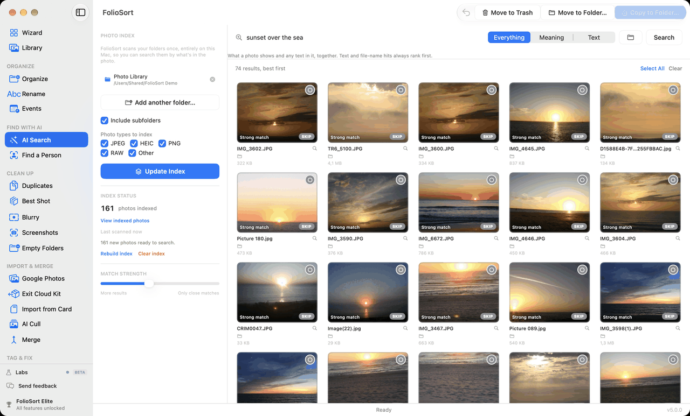 <b>AI Search</b> — describe it, get the photo. No upload, no account.</td>
<td width="50%">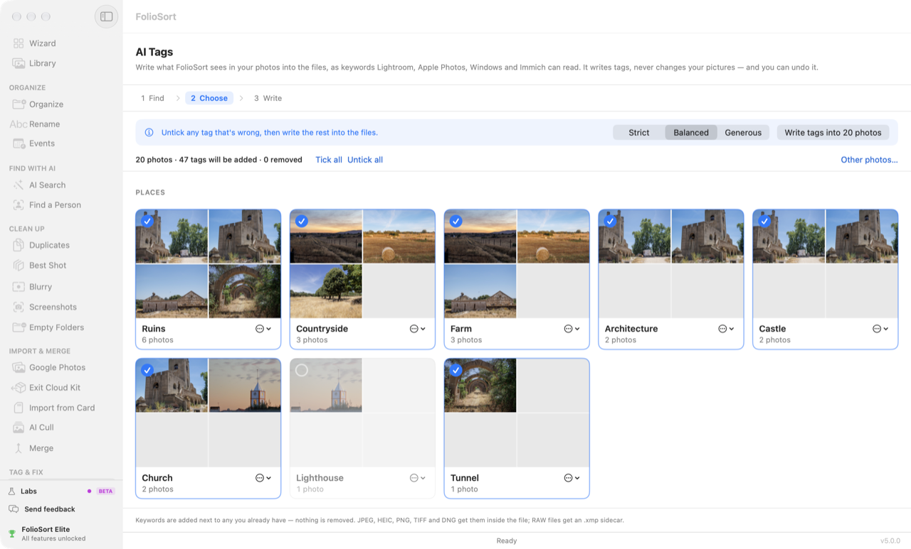 <b>AI Tags</b> — untick what's wrong, write the rest.</td>
</tr>
</table>

> **Free includes an AI taster** — search your first 500 photos, find a person in 20, cull the first 20 photos of any folder. Elite unlocks your whole library.

### 🤖 Ask Your AI — your photo library, inside Claude

FolioSort 5 can act as an **MCP server**: connect **Claude Desktop** (or ChatGPT's Codex, or any MCP app) and ask *"find the photos from the Porto trip where we're at the beach"* in the chat you already use. **Read-only, and no image is ever sent** — the AI gets search results, not your photos. → [How it works](https://www.foliosort.app/features/ask-your-ai?utm_source=github&utm_medium=readme&utm_campaign=v5)

---

## 🛡️ Protect — a backup that proves it is a copy

A backup nobody checks is a hope. FolioSort copies your library to another drive or a NAS, **reads every file back** to prove the copy is identical, and later finds the photos that changed or quietly went bad — then puts them back from the copy.

- **Backup Copy** — the same folder structure on the backup drive, every copy compared by hash, then only new photos. **Deleting a photo never deletes it from the backup.**
- **Archive Health** — every file fingerprinted once, then reported as intact, modified, corrupted, missing or new. Damaged files are **restored from the verified backup**.
- **Monthly check** (Elite) — Archive Health runs on its own every month and saves an HTML health report.

<table>
<tr>
<td width="50%">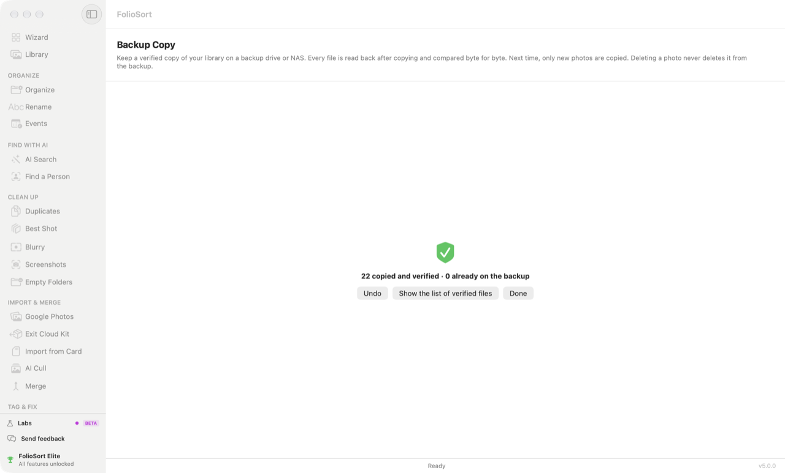 <b>Backup Copy</b> — 22 copied, 22 verified.</td>
<td width="50%">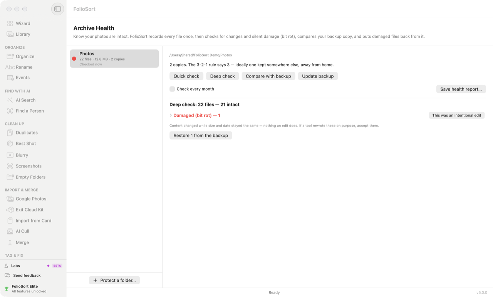 <b>Archive Health</b> — 1 file with bit rot, restored from the backup.</td>
</tr>
</table>

---

## ☁️ Own it — fix Google Photos Takeout and leave the cloud

Your memories shouldn't live on someone else's computer. But leaving Google Photos or iCloud usually means a broken export: dates reset to today, GPS stripped, albums scattered. FolioSort repairs all of it.

- **Google Takeout rescue — free forever, no file limit.** Reads Google's `.json` sidecars and writes the real date, GPS and people back into each file. Detects `.CR2`/`.CR3` files that Takeout actually saved as JPEGs.
- **Exit Cloud Kit** — guided import from **Google Takeout, WhatsApp, Amazon Photos, OneDrive and iCloud** exports, with an **Exit Report** of what came across.
- **NAS-ready** — Synology, QNAP, SMB/AFP shares, Immich-friendly folder structures. Moving within one share is a rename on the server.
- **Cloud placeholders respected** — OneDrive, iCloud Drive and Dropbox placeholders are recognised *without being opened*, so a scan never silently downloads your library.

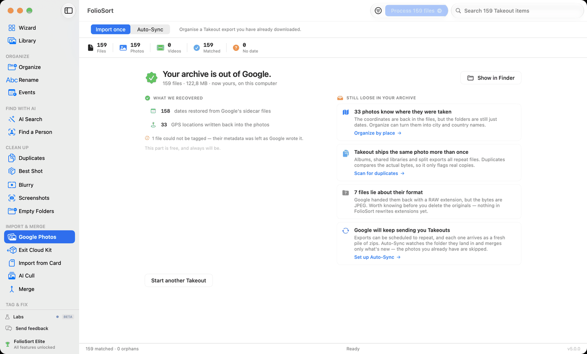

---

## ⚙️ Automate — set it up once

- **Workflows** (Elite) — your whole import ritual (organize, remove duplicates, rename, update the backup) saved as one button, with a review pause between steps and per-step Undo.
- **Watch Folders** (Elite) — point one at your SD-card dump folder and it organizes on arrival.
- Same safety rails on every automated run: checksums, undo history, activity log.

<table>
<tr>
<td width="50%">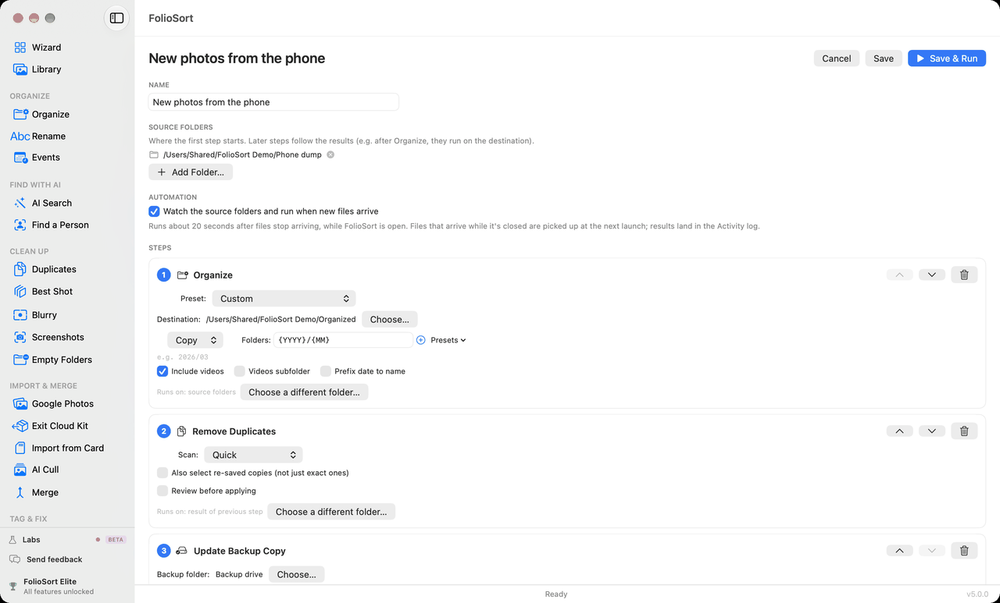 <b>Workflows</b> — one click, the whole ritual.</td>
<td width="50%">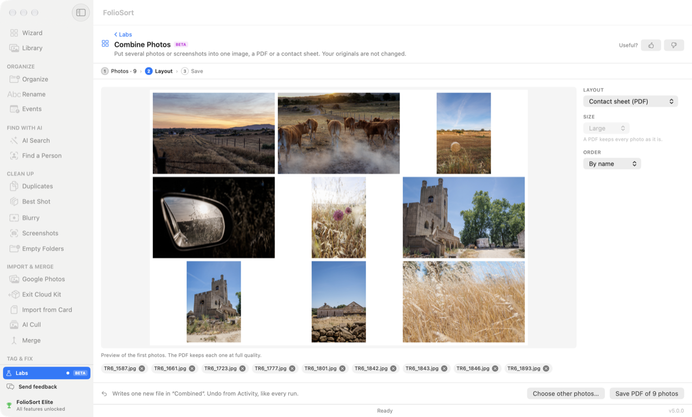 <b>Labs (Beta)</b> — Combine Photos into one image, a PDF or a contact sheet.</td>
</tr>
</table>

**Like what you see?** ⬇️ **[Download FolioSort free](https://github.com/tiagotrindade/FolioSort/releases/latest)** — no account, no card. Browse your whole library free, forever.

---

## Who it's for

### 🗂️ Google Photos & iCloud refugees
The Takeout export is notoriously broken. FolioSort's Takeout import fixes it **for free, with no limit**, then gives you back the things you'll miss — a timeline, a map, *"On this day"*, face groups and AI search — on your own drives.

### 📷 Photographers
**AI Cull** a shoot and write it to Lightroom, sort by **camera body, lens or GPS city**, handle **91 formats** including RAW (CR3, NEF, ARW, DNG, RAF…) and cinema video (BRAW, R3D, ARRI), and keep a **verified backup** of the archive. Event time-blocks drop every camera's photos into the right part of the day.

### 👨‍👩‍👧 Families with 20 years of photos on 6 drives
See **every drive in one library** — even the one in the drawer. Find *"grandma's 80th birthday"* in a second. Clear the duplicates that every backup-of-a-backup leaves behind.

### 🧹 Everyone with a messy Downloads folder
One **Wizard**, three clicks, done. No metadata expertise required.

---

## 💶 Pricing — pay once, own it forever

**No subscription. No account. No cloud.** A real free tier, and a **14-day money-back guarantee** on every licence.

| | **Free** · €0 | **Pro** · €29.99 once | **Elite** · €39.99 once |
|---|:---:|:---:|:---:|
| **Library** — timeline, map, events, places, viewer | ✓ unlimited | ✓ | ✓ |
| **Google Takeout import** | ✓ always free | ✓ | ✓ |
| Organize by real capture date (EXIF) | 100 files/batch | **Unlimited** | **Unlimited** |
| Rename · Merge Sources · Undo | 100 files/batch | **Unlimited** | **Unlimited** |
| RAW & cinema formats, custom events, profiles, regex | limited | ✓ | ✓ |
| Places · Dates · Edit metadata (written into files) | 100 per run | **Unlimited** | **Unlimited** |
| Duplicates · Blurry · Screenshots cleanup | first 20 | ✓ | ✓ |
| Backup Copy + Archive Health | first 100 files | ✓ | ✓ |
| **AI Search** of your library | 500-photo taster | 500-photo taster | **Whole library** |
| **People** · **Find a Person** · **OCR** text search | taster | taster | **Whole library** |
| **AI Tags** — keywords written into files | 20 photos | 20 photos | **Unlimited** |
| **AI Cull** — write to Lightroom | 20 per folder | 20 per folder | **Every photo** |
| **Best Shot** | first 20 | first 20 | **Unlimited** |
| Smart Folders · Workflows · Watch Folders · auto-events | — | — | ✓ |
| Monthly archive check + health report | — | — | ✓ |
| Labs — Moved Files Map, Ask Your AI | ✓ | ✓ | ✓ |
| Devices per licence | — | 1 computer | **3 · Mac + Windows** |
| Support | — | standard | priority |

### [→ Get Elite — €39.99 once](https://www.foliosort.app/upgrade?utm_source=github&utm_medium=readme&utm_campaign=buy_elite_v5) &nbsp;·&nbsp; [→ Get Pro — €29.99 once](https://www.foliosort.app/upgrade?utm_source=github&utm_medium=readme&utm_campaign=buy_pro_v5)

**Elite is only €10 more than Pro** — and adds every feature that runs a neural network, automation, and 3 devices across Mac and Windows.

**Do the math:** on-device AI photo search alone costs **$199–249** (Excire Foto); AI culling alone is **$120+/year, forever** (Aftershoot, Narrative). **FolioSort Elite does search + people + OCR + culling + automation for €39.99, once.**

1. Complete checkout (Lemon Squeezy, merchant of record) → your **licence key** arrives by email in seconds
2. Open FolioSort → **Settings → Upgrade** → paste the key → **Activate**
3. Unlocked forever — and **FolioSort 5 is a free update** for everyone who already bought Pro or Elite

---

## Why FolioSort

- **🔒 Private by design** — no cloud, no account, no upload. All AI search, face grouping, culling and OCR run on-device, **with Wi-Fi off**. Optional reverse geocoding sends only GPS coordinates (never your files); anonymous usage analytics never include file names, paths or GPS.
- **🛟 Safe by design** — Copy mode by default, every transfer checksum-verified, everything removed goes to the Trash, and **one-click Undo** reverses any batch — including the ratings, keywords, dates and places FolioSort wrote into your files.
- **🗄️ Your files stay plain files** — no catalog to export from, no proprietary database. Uninstall FolioSort tomorrow and your library is still a clean set of dated folders with the metadata *inside* the photos.
- **⚡ Built for bulk** — tested on libraries of 100,000+ photos; finishing a 50,000-photo scan takes seconds; a duplicate scan holds a flat ~6 MB of memory however large the drive.
- **🖥️ Truly native** — Swift/SwiftUI on macOS, .NET WPF on Windows. No Electron.
- **👋 Made by one person** — an independent developer in Lisbon, no venture capital. Support is a reply from the person who wrote the code — 94 releases since March 2026.

---

## How FolioSort compares

| | **FolioSort 5** | Lightroom / Apple Photos | Google Photos / iCloud | DIY scripts |
|---|:---:|:---:|:---:|:---:|
| Works on **your existing folders** — no import | ✓ | — | — | ✓ |
| Library view: timeline, map, people, events | ✓ | ✓ | ✓ | — |
| Organizes the **actual files & folders on disk** | ✓ | — | — | ✓ |
| Fixes **Google Takeout** broken dates | ✓ free | — | — | partial |
| **AI search**, faces, OCR | ✓ on-device | device-dependent | ✓ in the cloud | — |
| **AI culling** → XMP for Lightroom | ✓ | manual | — | — |
| Duplicate · blurry · screenshot cleanup | ✓ | partial | partial | — |
| **Verified backup** + bit-rot check | ✓ | — | — | — |
| Photos **stay on your computer** | ✓ | ✓ | — | ✓ |
| macOS **and** Windows, native | ✓ | varies | web | varies |
| Pricing | **one-time** | free–subscription | subscription | free |

FolioSort keeps the library as **plain folders** and does everything around them. You only need something else to *develop* RAW files (Lightroom, Capture One) or to serve photos to a phone from a server (Immich, PhotoPrism) — and FolioSort writes the ratings, keywords, people and places those apps read.

---

## How to install

### macOS — FolioSort 5.0.0
1. Download [**`FolioSort.dmg`**](https://github.com/tiagotrindade/FolioSort/releases/latest/download/FolioSort.dmg).
2. Open the DMG and drag **FolioSort** to **Applications**.
3. Launch it — **signed and notarized by Apple**, so it opens with no Gatekeeper warning.

macOS 14 (Sonoma) or later · Apple Silicon or Intel.

### Windows — FolioSort 4.9.9 (FolioSort 5 coming soon)
1. Open the **[FolioSort listing on the Microsoft Store](https://apps.microsoft.com/detail/9nlw1xwgk181?cid=github)**.
2. Click **Get** — the Store installs it and keeps it up to date, so you'll get FolioSort 5 automatically when it lands.

Windows 10 (1809) or later, x64. Certified by Microsoft — no SmartScreen warnings. A portable `.zip` is attached to [Windows releases](https://github.com/tiagotrindade/FolioSort/releases) for machines without the Store.

---

## FAQ

### What is new in FolioSort 5?
A **Library** of every photo on every drive (free, no limit), **AI Cull** with *Write for Lightroom*, **Best Shot**, **AI Tags**, **Places / Dates / Edit metadata** written into your files, **Backup Copy** and **Archive Health**, **Labs**, and **Ask Your AI** for Claude Desktop. It's a free update for every Pro and Elite owner. See the [release notes](https://github.com/tiagotrindade/FolioSort/releases/tag/v5.0.0).

### Does FolioSort import or copy my photos into a catalog?
No. The Library is an **index, not an import** — your photos stay exactly where they are. Unplug a drive and its photos stay on screen, greyed; plug it back in and they return in place.

### How do I organize thousands of photos into folders by date?
Point FolioSort at the folder, drive or NAS share, pick a structure like `Year/Month/Day`, and press Start. It reads the **real capture date from the EXIF** — not the date the file was copied — previews the exact result before anything moves, verifies every transfer, and keeps one-click Undo.

### How do I fix the broken dates in my Google Photos Takeout export?
Point FolioSort's Google Photos mode at the extracted Takeout folder. It reads the `.json` sidecars Google ships alongside each photo, writes the real date, GPS and people back into the files, and sorts everything into dated folders. **Free, no file limit.** No scripts, no ExifTool command lines.

### Can I search my photos like in Google Photos — without the cloud?
Yes. Type *"the dog on the beach"*, browse **by person**, or search the **text inside** your images — all on your own machine, with Wi-Fi off. The free tier searches your first 500 photos; Elite searches the whole library.

### Can I cull a shoot in FolioSort and keep editing in Lightroom?
Yes. **AI Cull** stacks near-identical frames and suggests the sharpest; you keep or reject with one key. **Write for Lightroom** saves your stars, colour labels and rejects as standard XMP — Lightroom, Capture One, Bridge and Photo Mechanic read them. RAW files get a sidecar and are never modified.

### Is it safe to run on the only copy of my photos?
FolioSort is built around not losing files: **Copy mode is the default**, every transfer is checksum-verified before a source is ever removed, deletions go to the Trash / Recycle Bin, every batch has Undo, and the destination is tested before a run starts. And now **Backup Copy** gives you a second copy that's actually been checked. Still: always keep a backup of irreplaceable photos.

### Does it work offline? Where do my photos go?
Nowhere. Scanning, AI search, faces, OCR, culling, duplicates and organizing all run on your computer. No account, no upload. The only optional network feature is reverse geocoding, which sends GPS coordinates (never images).

### Is FolioSort free? What's the catch?
No catch, no trial clock, no watermarks. **The Library and Google Takeout import are free with no limit**; organizing, renaming and fixing metadata are free 100 files at a time; scanning for duplicates and blurry shots is free and unlimited, with your first 20 cleanups included; and there's an AI taster. **Pro** (€29.99 once) removes every limit; **Elite** (€39.99 once) adds the AI on your whole library, automation, and 3 devices. No subscription, ever.

### Can I use one licence on my Mac and my Windows PC?
With **Elite**, yes — one key activates on up to 3 devices, mixing Mac and Windows. Pro covers 1 computer.

### Does it handle RAW photos and video?
Yes — **91 formats**: 46 everyday photo and video formats free, plus 45 RAW and cinema formats with Pro (Canon CR2/CR3, Nikon NEF, Sony ARW, Fujifilm RAF, DNG, BRAW, R3D, ARRI…). See the [full list](#supported-formats).

### Why not just use Apple Photos or Lightroom?
Those manage a *library database*. FolioSort works on the **actual files and folders on disk** — ideal if you archive to a NAS or external drives, want a structure that outlives any app, or need to clean up a mess *before* importing it anywhere. And it writes ratings, keywords, places and people into the files, so Lightroom sees FolioSort's work.

---

## Supported formats

**Photos:** JPG, JPEG, JFIF, PNG, HEIC, HEIF, TIFF, TIF, BMP, GIF, WebP, AVIF, JXL, JP2, J2K, JPF, JPX, JXR, WDP, HDP

**RAW Photos (Pro):** CR2, CR3, CRW (Canon) · NEF, NRW (Nikon) · ARW, SR2, SRF (Sony) · DNG (Adobe) · ORF (Olympus) · RAF (Fujifilm) · RW2 (Panasonic) · PEF, PTX (Pentax) · SRW (Samsung) · X3F (Sigma) · RWL, RAW (Leica) · MRW (Minolta) · 3FR, FFF (Hasselblad) · IIQ, CAP (Phase One) · KDC, DCR, K25 (Kodak) · ERF (Epson) · GPR (GoPro) · MEF (Mamiya) · BAY (Casio) · STI (Sinar) · MOS (Leaf)

**Videos:** MOV, MP4, AVI, MKV, M4V, 3GP, 3G2, WMV, ASF, FLV, F4V, WebM, MTS, M2TS, TS, M2T, MPG, MPEG, MP2, VOB, DV, OGV, OGG, RM, RMVB, DivX, XviD

**RAW Video (Pro):** BRAW (Blackmagic) · R3D (RED) · ARI, ARX (ARRI) · CRM (Canon Cinema) · MXF (Sony) · CINE (Phantom) · INSV (Insta360) · LRV (GoPro) · OP1, OP2 (Panasonic P2) · DNxHD (Avid) · FCPVID (Final Cut)

**Other (Pro):** any file type via the "Other Files" toggle

---

## Changelog

**v5.0.0 — 14 Oct 2026 · macOS.** FolioSort becomes somewhere you stay: the **Library**, **AI Cull**, **Best Shot**, **AI Tags**, **Places / Dates / Edit metadata**, **Backup Copy + Archive Health**, **Labs** and **Ask Your AI** · AI Search prepares its engine in the background, so the first index starts straight away · 50,000-photo scans finish in seconds · Duplicates and Best Shot remember the last scan · Live Photos stay together in Organize and Rename. → [Full notes](https://github.com/tiagotrindade/FolioSort/releases/tag/v5.0.0)

**v4.9.x — both platforms.** AI Search **12.7× faster** (62 ms on 100,000 photos) · zoom to 8× · Events grouping interval · bulk *"Keep suggested, mark all the rest"* for Duplicates · cloud placeholders never downloaded behind your back · a 2 TB duplicate scan in a flat 5.8 MB of memory · write pre-flight across every module that moves files · place names written into photos (IPTC + XMP).

**v4.0 – v4.8.** People with automatic face grouping and XMP export · Exit Cloud Kit · on-device AI search + OCR · Workflows, Smart Folders, Best Shots · Merge Sources · Windows parity.

Every version: [Releases](https://github.com/tiagotrindade/FolioSort/releases) · [foliosort.app/changelog](https://www.foliosort.app/changelog?utm_source=github&utm_medium=readme&utm_campaign=v5)

---

## About this repository

This repository hosts FolioSort's **releases, documentation and issue tracker**.
FolioSort is a proprietary application and its source code is not published —
see [LICENSE](LICENSE).

Every macOS and Windows build is published here under
[Releases](https://github.com/tiagotrindade/FolioSort/releases), and that is
also where the in-app updater fetches them from. Bug reports and feature
requests are welcome in [Issues](https://github.com/tiagotrindade/FolioSort/issues) —
or write to **feedback@foliosort.app** — we usually ship a fix within hours.

---

### ⭐ If FolioSort saved you an afternoon of sorting, [star this repo](https://github.com/tiagotrindade/FolioSort) — it's how other people find it.

Know someone with 30,000 photos in one folder? **[Send them the link](https://foliosort.app?utm_source=github&utm_medium=readme&utm_campaign=share)** — the free tier is enough to fix their Takeout export tonight.

⬇️ **[Download for macOS](https://github.com/tiagotrindade/FolioSort/releases/latest/download/FolioSort.dmg)** · 🪟 **[Get it on the Microsoft Store](https://apps.microsoft.com/detail/9nlw1xwgk181?cid=github)** · 🌐 **[foliosort.app](https://foliosort.app?utm_source=github&utm_medium=readme&utm_campaign=footer)**

